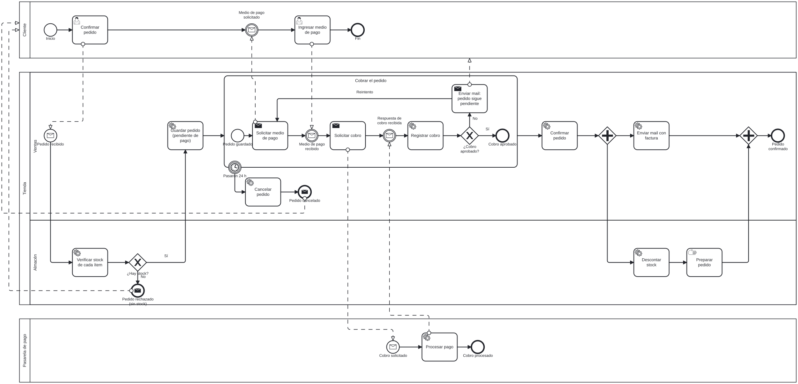

# Procesos

## Realizar pedido con pago (BPMN)

Proceso entre Cliente, Tienda (carriles Ventas y Almacén) y Pasarela de pago.
Incluye el temporizador de 24 h y el reintento tras un cobro rechazado.

Fuente editable: [pedido_con_pago.bpmn](pedido_con_pago.bpmn)