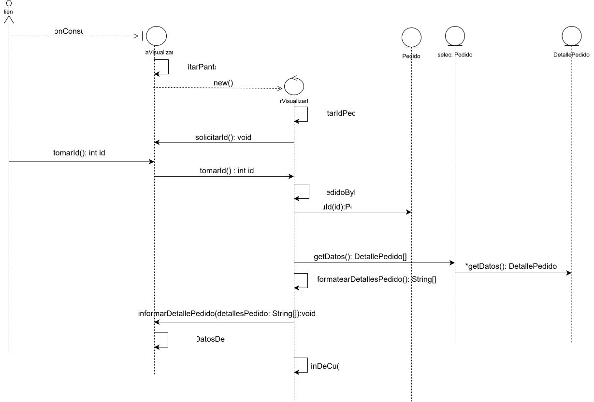

# UML

## Casos de uso

Actores Cliente y Administrador, que heredan de User las funciones de sesión y perfil.
La Pasarela de pago participa como actor externo en el cobro.

- `«include»`: Realizar pedido siempre requiere Procesar pago.
- `«extend»`: Exportar PDF es opcional sobre Visualizar pedidos.

## Secuencia: consultar pedido

Camino feliz con estereotipos Boundary, Control y Entity.
El gestor coordina la búsqueda y la pantalla recibe los datos ya formateados.

Fuente editable: [secuencia-consultar-pedido.drawio](../fuentes/DiagramasUML)