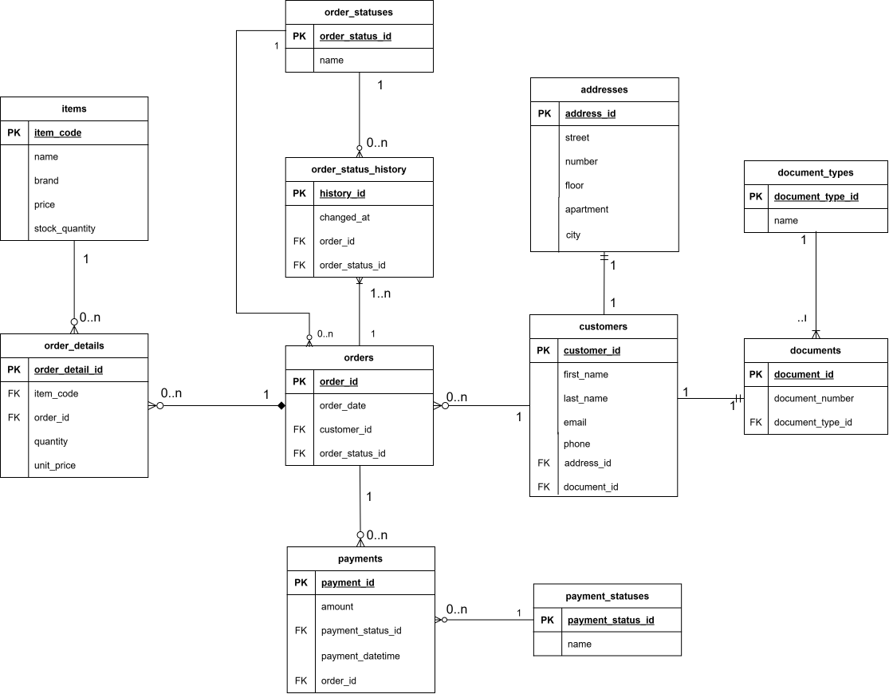

# Base de datos

Base relacional del sistema de pedidos, para PostgreSQL 16.

## Contenido

| Archivo | Qué contiene |
|---|---|
| `schema.sql` | Tablas, restricciones, índices sobre claves foráneas y el trigger que sincroniza el estado del pedido |
| `seed.sql` | Datos de prueba: 12 clientes, 15 ítems, 24 órdenes con su historial de estados y 28 pagos |
| `consultas.sql` | 10 consultas de ejemplo, cada una con su descripción |

## Modelo entidad-relación

Modelo de la tienda: clientes, pedidos, detalle de pedidos, ítems, cobros y estados.



Fuente editable: [der_pedidos.drawio](../fuentes/der_pedidos.drawio)

## Decisiones de modelado

- **Pedido y cobros (1 a 0..n):** cada intento de cobro queda registrado, aprobado o rechazado, para auditoría y detección de fraude. Un pedido cancelado por falta de pago puede no tener ningún cobro.
- **Reintegros:** se registran como un cobro nuevo con estado `REFUNDED`, sin modificar el cobro original, para conservar el historial completo.
- **Estados en tablas separadas:** `order_statuses` y `payment_statuses` son catálogos distintos, para que un cobro no pueda tener un estado de pedido. Valores: `PENDING_PAYMENT`, `CONFIRMED`, `CANCELLED` para pedidos, y `APPROVED`, `REJECTED`, `REFUNDED` para cobros.
- **Historial de estados del pedido:** `order_status_history` guarda cuándo entró el pedido en cada estado. El fin de un estado es el inicio del siguiente, por lo que no se guarda una segunda fecha.
- **Estado actual en `orders`:** se guarda para no buscar la última fila del historial en cada consulta. Un trigger (`trg_history_sync_order_status`) lo mantiene sincronizado: cada vez que se inserta una fila en el historial, se copia a `orders` el estado más reciente por fecha.
- **`unit_price` en `order_details`:** conserva el precio al momento de la compra, y los pedidos viejos no cambian si el ítem cambia de precio.
- **Total del pedido:** no se almacena, se calcula con `quantity * unit_price`.
- **Cliente y dirección (1 a 1):** cada cliente tiene una única dirección, que se registra con el alta. Lo mismo con su documento. Se garantiza con restricciones `UNIQUE` sobre las claves foráneas.
- **Clientes sin pedidos:** se permiten, para futuras comunicaciones y ofertas.
- **Detalles de pedido:** se eliminan en cascada con su pedido.

## Glosario

| Español | Tabla |
|---|---|
| Cliente | `customers` |
| Dirección | `addresses` |
| Documento y tipo de documento | `documents`, `document_types` |
| Ítem | `items` |
| Pedido y detalle de pedido | `orders`, `order_details` |
| Cobro | `payments` |
| Estado de pedido y de cobro | `order_statuses`, `payment_statuses` |
| Historial de estados | `order_status_history` |

## Cómo ejecutarlo

Requisito: PostgreSQL 16 (el script usa columnas `IDENTITY`, triggers en PL/pgSQL y `IS DISTINCT FROM`, por lo que no es compatible con MySQL).

**1. Crear la base de datos**

```bash
psql -U postgres -c "CREATE DATABASE pedidos;"
```

**2. Cargar el esquema y los datos, en este orden**

```bash
psql -U postgres -d pedidos -f schema.sql
psql -U postgres -d pedidos -f seed.sql
```

**3. Ejecutar las consultas**

```bash
psql -U postgres -d pedidos -f consultas.sql
```
Si preferís una interfaz gráfica (pgAdmin, DataGrip), creá la base `pedidos`, abrí cada archivo en el editor de consultas y ejecutalo en el mismo orden. Para las consultas, ejecutá de a una, ya que muchos clientes muestran solo el resultado de la última sentencia.

**Para empezar de cero**

```sql
DROP SCHEMA public CASCADE;
CREATE SCHEMA public;
```

## Verificación

Con los datos de prueba cargados, estas consultas deberían devolver:

| Consulta | Resultado esperado |
|---|---|
| 4. Clientes con más de 3 órdenes | Juan (5), Lucas (4) y María (4) |
| 7. Órdenes con saldo pendiente | Órdenes 9, 17, 21, 22 y 23 |
| 9b. Control de consistencia de estados | Ninguna fila |
| 10. Meses sobre el promedio de facturación | Enero y abril de 2026 |