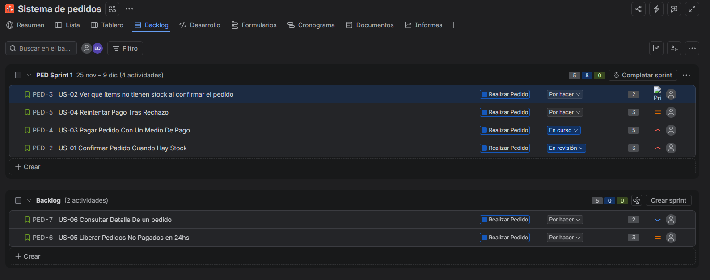
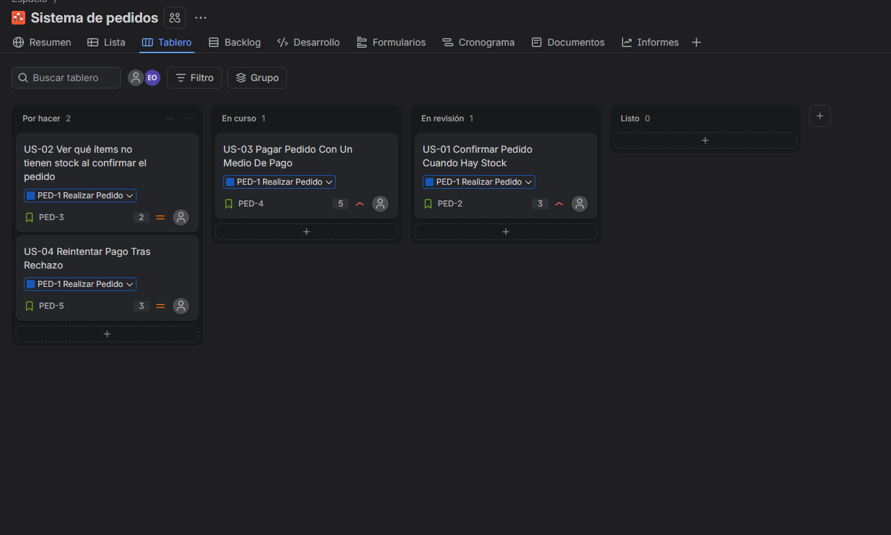
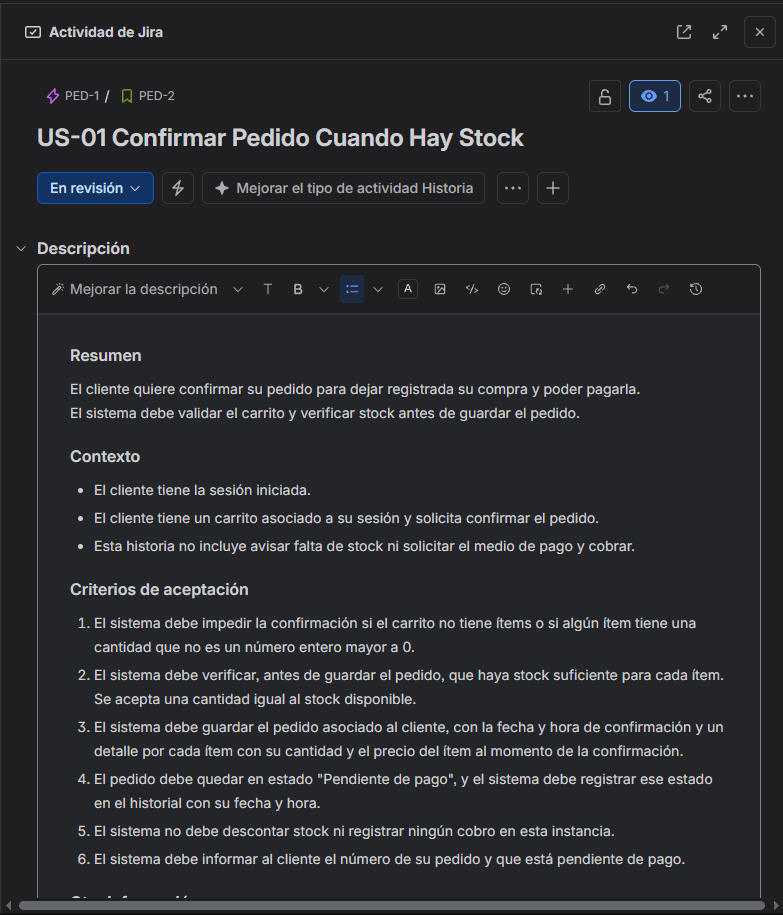

# Gestión ágil

Sprint de ejemplo con las historias de la épica "Realizar pedido", armado en Jira para ilustrar la planificación.

## Backlog

Épica con seis historias, con prioridad y puntos de historia, y un sprint de dos semanas.

## Tablero del sprint

## Historia de usuario (US-01)

Descripción con precondiciones, criterios de aceptación y casos de prueba.

